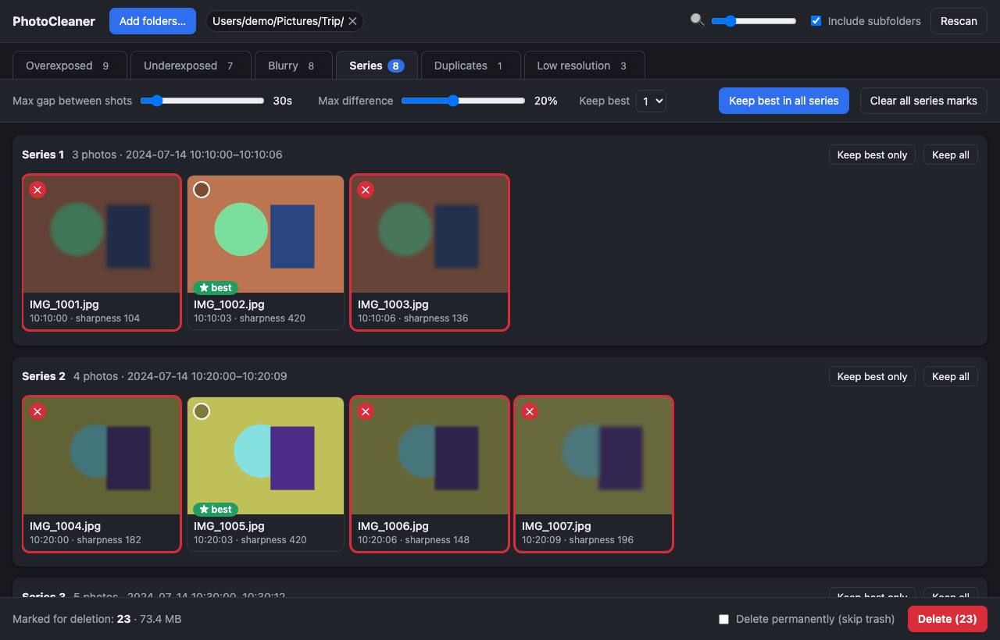
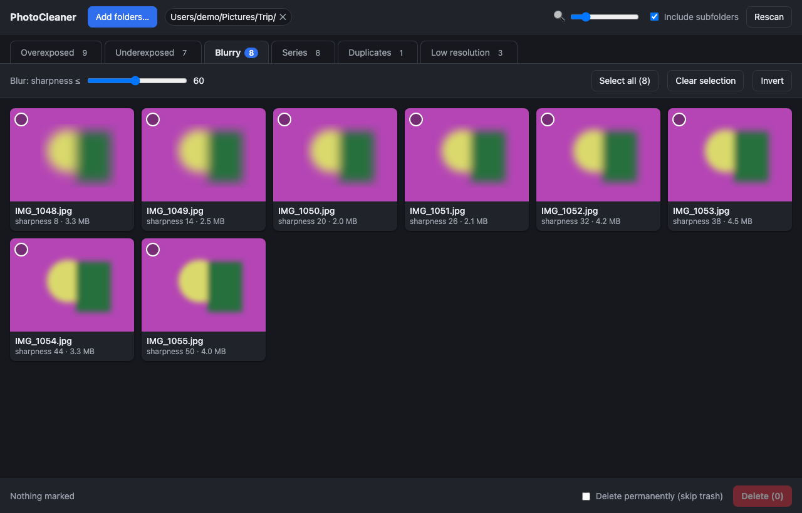
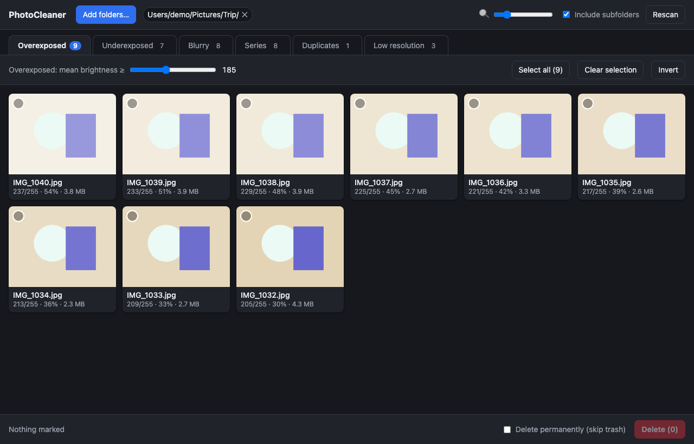

# PhotoCleaner

Cross-platform desktop app (macOS · Windows · Linux) that helps you throw away the bad photos fast.
Built with [Tauri v2](https://tauri.app) (Rust core + plain HTML/JS UI). Everything runs locally; no photo ever leaves your machine.

## Screenshots

> Screenshots use synthetic demo data (`ui/mock.js`), not real photos.

**Series** — the best shot of every burst is kept (★), the rest is pre-marked for deletion:



**Blurry** and **Overexposed** categories with live threshold sliders:




## What it does

Pick one or more folders and PhotoCleaner scans them (in parallel, all CPU cores) and groups photos into:

| Tab | What is found |
|---|---|
| **Overexposed** | washed-out / blown-out shots (high mean brightness or many clipped white pixels) |
| **Underexposed** | too dark shots (low mean brightness or many crushed black pixels) |
| **Blurry** | out-of-focus / motion-blurred shots (variance of Laplacian) |
| **Series** | bursts of near-identical shots taken close in time; the best one is picked automatically |
| **Duplicates** | exact copies of the same photo (same image hash and file size) |
| **Low resolution** | photos below a megapixel threshold (thumbnails, messenger downloads) |

* Every threshold is a slider — the lists update instantly, no rescan needed.
* Click a card to mark it for deletion (red), double-click or ⤢ for a full-size preview with ←/→ navigation and Space to mark.
* **Series**: "Keep best in all series" marks everything except the top-N shots of every series in one click; fix individual series with "Keep best only" / "Keep all" or by clicking single photos.
* Deletion goes to the system **Trash / Recycle Bin** by default; tick *Delete permanently* to bypass it. The app only deletes files it found during the last scan.

### How the "best" shot is chosen

Within a series each photo gets a score: 65 % sharpness (log-scaled Laplacian variance), 25 % exposure quality (close to mid-grey, few clipped pixels), 10 % resolution. Series are formed from photos sorted by capture time (EXIF `DateTimeOriginal`, falling back to file modification time) where neighbours are within the chosen time gap *and* their 256-bit perceptual difference hash differs by at most the chosen percentage.

## Supported formats

JPEG, PNG, WebP, TIFF, BMP, GIF. **HEIC/HEIF and RAW are not supported yet** (PRs welcome — e.g. via `libheif`).

## Development

Requirements: [Rust](https://rustup.rs) ≥ 1.90, Node.js ≥ 18, and the [Tauri prerequisites](https://tauri.app/start/prerequisites/) for your OS.

```bash
npm install
npm run dev        # run the app
npm run build      # produce an installer / .app / .msi in src-tauri/target/release/bundle
cd src-tauri && cargo test   # unit tests for the analysis code
```

The UI has no build step (`ui/`). To iterate on it in a normal browser with fake data run `npm run ui` and open <http://localhost:1420> (`ui/mock.js` stands in for the Rust backend). Open `ui/index.html#demo=series` (or `over`, `blur`, `dups`, `low`) to auto-load a demo state, as used for the screenshots.

### Layout

```
src-tauri/src/analyze.rs   image analysis: exposure, sharpness, dHash, EXIF time, thumbnails
src-tauri/src/main.rs      Tauri commands: scan, cancel_scan, delete_files
ui/                        index.html, app.js (state, grouping, i18n uk/en), style.css, mock.js
```

## Roadmap ideas

HEIC/RAW support, face/closed-eyes detection for series ranking, exact-duplicate detection across folders, persisted analysis cache, drag-and-drop folders.

## License

[MIT](LICENSE) © Maksym Skorchenko
